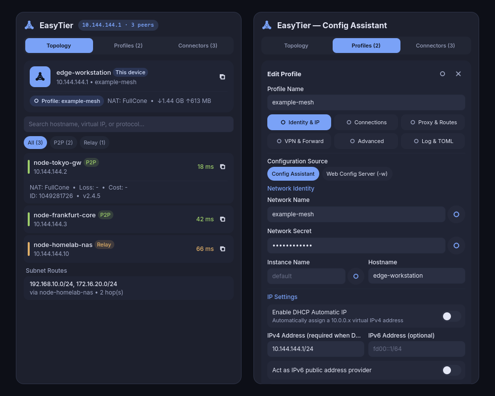

# EasyTier for Dux Shell (DMS 2)

Mesh VPN status monitor, official-style visual configuration assistant, dynamic bootstrap connector manager, and service controller for **EasyTier** on **Dux Shell (DMS `>=2.0.0`)**.



## Features

- **DankBar Pill & Control Center Tile**:
  - Displays live mesh connection status, peer count, virtual IPv4, or network name in the bar pill.
  - Supports right-click or middle-click quick daemon toggle and Control Center tile integration.
  - Adaptive polling: polls at the user-configured interval (`5–60s`) while the popout is open, and automatically backs off (`15s` when connected, `30s` when idle/disconnected) when the popout is closed.
- **Network Topology & Peer Inspector (`Topology`)**:
  - Local node card with hostname, virtual IPv4 (one-click copy), active profile/service badge, NAT type, and cumulative RX/TX traffic.
  - Expandable peer list with **P2P** / **Relay** badges, latency color coding, tunnel protocol, packet loss, NAT type, and search/filter chips.
  - Subnet proxy route table showing advertised `Proxy CIDRs` and next-hop paths.
- **Built-in Config Assistant (`Profiles`, aligned with `easytier.cn/assistant/`)**:
  - 6-section visual profile editor (**Identity & IP**, **Connections**, **Proxy & Routes**, **VPN & Forward**, **Advanced**, **Log & TOML**) supporting both local TOML generation and Web Config Server (`-w` + `--machine-id`) mode.
  - Covers DHCP / static IPv4 & IPv6, public shared bootstrap node or manual peers, listeners, subnet proxy CIDRs, manual routes, exit nodes, SOCKS5 proxy, WireGuard VPN portal, TCP/UDP port forwards, encryption algorithms (`aes-gcm`, `aes-256-gcm`, `chacha20`, `xor`), Zstd compression, and 29 advanced flags (including `--no-tun` / `smoltcp`, KCP/QUIC proxy, and private mode).
  - Live TOML preview with masked secrets and pre-flight validation via `easytier-core --check-config`.
- **Dual Backend Modes**:
  - **Managed Profile (`dms-easytier-managed.service`)**: Launches and manages an isolated `easytier-core` instance directly from saved profiles (`127.0.0.1:15889` RPC by default).
  - **Systemd Service (`easytier.service`)**: Controls an existing system or user systemd unit (`127.0.0.1:15888` RPC by default).
- **Dynamic Bootstrap Connectors (`Connectors`)**:
  - Inspects active outbound connectors and hot-adds or removes `tcp://`, `udp://`, `ws://`, `wss://`, `wg://`, and `quic://` peer URLs at runtime via `easytier-cli connector`.

## Dependencies

- **Dux Shell (DMS)**: `>= 2.0.0`
- **`easytier-core`** & **`easytier-cli`** (`>= 2.0`)
- **`jq`** (JSON parsing, profile normalization, and TOML rendering)
- **`systemd`** (`systemctl` and `systemd-run` for service management)
- **`polkit`** (`pkexec`, optional — only used when starting/stopping system-scope services or TUN-enabled managed profiles that require `CAP_NET_ADMIN`)

## Security, Privilege & Network Model

- **Credential Isolation**: Saved profiles are stored in `~/.config/easytier-dms/profiles.json` with `0600` permissions. `network_secret` is stripped from all status and summary outputs before reaching QML; secrets are passed to `easytier-core` exclusively via `0600` runtime config/environment files (`managed.toml` / `managed.env`) rather than command-line arguments.
- **Privilege Scope**:
  - Status polling and RPC queries run completely unprivileged as the current user.
  - Profiles with **No TUN (`--no-tun`)** enabled run entirely in `systemd --user` scope without root privileges.
  - Profiles that create a kernel TUN interface (or system-scope systemd units) use `pkexec` on explicit user start/stop actions to launch a transient systemd unit bounded to `CAP_NET_ADMIN CAP_NET_RAW CAP_NET_BIND_SERVICE`.
- **Network Activity**:
  - The plugin helper queries the local `easytier-core` RPC portal (`127.0.0.1:15888` or `127.0.0.1:15889`) over loopback.
  - When an EasyTier daemon or managed profile is started by the user, `easytier-core` connects to the peer/bootstrap URLs configured in the active profile (for example, the optional public shared node `tcp://public.easytier.cn:11010` if selected by the user).

## Installation

Install from the **Dux Plugin Registry** in **DMS Settings -> Plugins**, or install manually:

```bash
mkdir -p ~/.config/dms/plugins
git clone https://github.com/DotRedstone/dms-plugin-easytier.git ~/.config/dms/plugins/easytier
dms ipc call plugin-scan scan
```

Enable **EasyTier** in **DMS Settings -> Plugins**, then add it to your **Bar** or **Control Center**.

## IPC Commands

```bash
dms ipc call easytier status
dms ipc call easytier popout
dms ipc call easytier toggle
dms ipc call easytier start
dms ipc call easytier stop
dms ipc call easytier restart
dms ipc call easytier refresh
```

---

## 中文文档

面向 **DMS 2 (Dux Shell)** 的 **EasyTier** 网格组网状态监控、官方风格可视化配置助手、动态连接器热管理与服务控制插件。

### 核心功能

- **内置官方风格配置助手（对齐 `easytier.cn/assistant/`）**：
  - 在弹窗 **组网方案 (`Profiles`)** 标签页内置 `3 × 2` 六分区编辑器，无需手写配置文件即可新建、编辑、保存并一键连接多套组网方案：
    1. **身份与 IP**：支持本地配置助手与 Web 配置中心 (`-w` + `--machine-id`) 切换；网络名称、网络密钥（显隐切换与随机生成）、实例名、主机名；DHCP 自动分配、静态 IPv4/IPv6 与公网 IPv6 提供/自动获取。
    2. **连接与监听**：支持手动配置节点与独立服务端（仅监听）模式；一键填入官方公共共享节点 (`tcp://public.easytier.cn:11010`)；本地监听地址（一键填充默认 `11010/11011/11012` 端口）、公网映射监听地址 (`mapped_listeners`) 与 `--no-listener` 纯出站开关。
    3. **代理与路由**：子网代理 (`[[proxy_network]]`)、手动路由覆盖 (`routes`)、出口节点 (`exit_nodes`) 以及 SOCKS5 入站代理 (`socks5_proxy`)。
    4. **VPN 与转发**：WireGuard VPN Portal (`[vpn_portal_config]`) 客户端网段与监听端口；可视化 TCP/UDP 端口转发规则卡片 (`[[port_forward]]`)。
    5. **高级选项**：默认传输协议、加密算法 (`aes-gcm` / `aes-256-gcm` / `chacha20` / `xor`)、Zstd 数据压缩 (`data_compress_algo`)、TUN MTU、多线程数、网卡名、Magic DNS 域名、中继网络白名单、外部中继与实例接收限速，以及全部 29 项高级布尔开关（低延迟优先、免 TUN / `smoltcp`、P2P 打洞控制、KCP / QUIC 代理与转发控制、私有模式、全局 UDP 广播中继等）。
    6. **日志与 TOML 实时预览**：控制台与文件日志级别配置；实时渲染 `easytier-core` 原生兼容的 TOML 配置（默认遮罩密钥，支持一键复制完整 `TOML`）。
  - **凭据隔离与预检**：方案保存在权限为 `0600` 的 `~/.config/easytier-dms/profiles.json`；托管启动时渲染 `0600` 运行时 `managed.toml`，先执行 `easytier-core --check-config` 校验，再通过 `-c` 加载，避免命令行暴露密钥。
- **双运行模式无缝切换**：
  - **托管方案 (`Managed Profile`)**：由插件管理 `dms-easytier-managed.service`（默认隔离在 `127.0.0.1:15889` RPC，开启 TUN 时通过 `pkexec` 最小权限授予 `CAP_NET_ADMIN` / `CAP_NET_RAW` / `CAP_NET_BIND_SERVICE`；勾选免 TUN 时纯用户态无感运行）。
  - **系统服务 (`Systemd Service`)**：直接启停现有的系统级或用户级 `easytier.service`（默认 `127.0.0.1:15888` RPC）。
- **动态连接器热管理 (`Connectors`)**：运行期间无需中断现有组网，直接在弹窗内查看出站连接器状态并动态添加/移除 `tcp://`、`udp://`、`ws://`、`wss://`、`wg://`、`quic://` 远端节点。
- **拓扑详情与检索 (`Topology`)**：
  - 本机节点卡片：主机名、虚拟 IPv4（一键复制）、组网名称、当前运行模式徽标、NAT 类型与累计收发流量。
  - 远端节点列表：自动过滤 `Local` 回环项，展示 **P2P 直连** / **Relay 中转**徽标、协议、延迟着色、收发字节统计，支持关键字搜索与直连/中转过滤。
  - 子网代理路由：自动展示网格内广播的 `Proxy CIDRs` 与下一跳信息。

### 验证与测试

```bash
chmod +x easytier-dms tests/test-helper.sh
shellcheck easytier-dms tests/test-helper.sh
./tests/test-helper.sh
jq -e . plugin.json
```

## License

MIT
